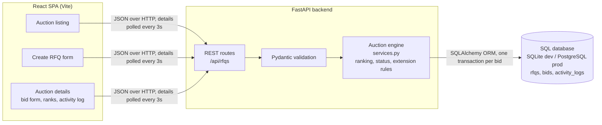
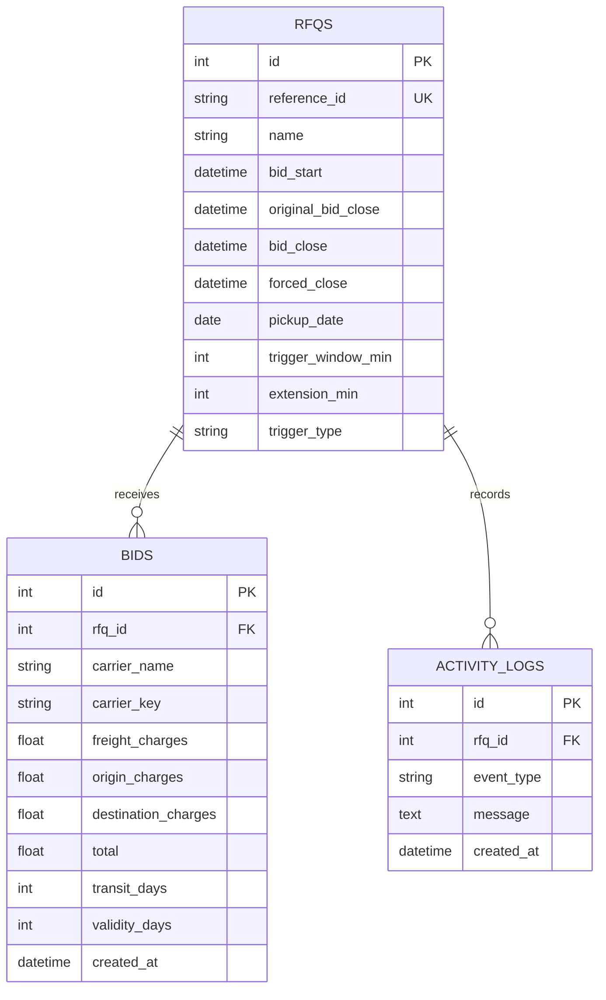

# British Auction RFQ: High-Level Design

## 1. Architecture

**Flow of a bid** (`POST /api/rfqs/{id}/bids`)

1. Lock before reading RFQ state: `SELECT ... FOR UPDATE` locks the RFQ row on PostgreSQL; `BEGIN IMMEDIATE` reserves the SQLite writer before the RFQ query. Concurrent SQLite bids wait for the previous transaction to commit, then read its updated close time and supplier bids. This keeps extension decisions consistent. SQLite serialises all writers, so PostgreSQL is preferable for higher write volume.
2. Reject if the auction has not started or `now >= bid_close`.
3. Reject if the supplier's total is not lower than its own previous best.
4. Snapshot ranking before, insert the bid, compute ranking after.
5. If `bid_close - X <= now < bid_close` and the configured trigger fires, set `bid_close = min(bid_close + Y, forced_close)`.
6. Write activity-log rows (bid, extension and reason, or "capped at forced close") and commit.

All timing uses the **server clock** (UTC). The client only displays a countdown, corrected by the server time offset returned with each details response.

## 2. Components

| Layer | Responsibility |
|---|---|
| React SPA | Listing, RFQ creation (with client-side rule checks), details page with live countdown, ranked bids, config and activity log |
| FastAPI routes | HTTP contract, error mapping (400 business rule, 404, 409 duplicate reference, 422 validation) |
| Pydantic schemas | Field validation, plus `forced_close > bid_close > bid_start` |
| Auction engine | Pure business logic: ranking, status, trigger evaluation, extension and forced-close cap. Takes `now` as a parameter so it is unit-testable |
| Database | Source of truth. CHECK constraints repeat the time rules as a safety net |

## 3. API

| Method | Path | Purpose |
|---|---|---|
| POST | `/api/rfqs` | Create an RFQ with British Auction configuration |
| GET | `/api/rfqs` | Listing: name/ID, lowest bid, current close, forced close, status |
| GET | `/api/rfqs/{id}` | Details: config, all bids by price with ranks, activity log |
| POST | `/api/rfqs/{id}/bids` | Submit a quote |

## 4. Design decisions

- **Status is derived**, never stored, so it cannot go stale. `FORCE_CLOSED` means the auction closed with `bid_close == forced_close`; otherwise `CLOSED`. `UPCOMING` is an extra state before the start time.
- **Ranking**: each supplier is ranked by its lowest total; ties go to the earlier bid. A supplier must always undercut its own previous bid, so its latest bid is its best.
- **Triggers** (evaluated only for bids inside the window):
  - `BID_RECEIVED`: any accepted bid.
  - `ANY_RANK_CHANGE`: the ordered supplier list differs before vs after. A new supplier entering counts as a change.
  - `L1_CHANGE`: the first entry of the list differs before vs after.
- **Extension** is added to the *current* close time (6:00 + 5 min = 6:05) and capped at the forced close. If already at the cap, no extension happens and an `EXTENSION_CAPPED` log entry records why.
- **Money** is stored as floats rounded to 2 decimals for simplicity; use `NUMERIC` in production.
- **Real-time**: polling keeps the system simple. WebSockets/SSE would be the next step.

## 5. Scaling and next steps

- Move to PostgreSQL (`DATABASE_URL`) and add Alembic migrations.
- Authentication and roles (buyer vs supplier), with the supplier taken from the session instead of a free-text carrier name.
- WebSocket/SSE push; a background job to mark auctions closed and notify participants.
- Index on `(status-relevant times)` or a materialised "lowest bid" if listings get large.

## 6. Schema

See `schema.sql` (tables `rfqs`, `bids`, `activity_logs`).

